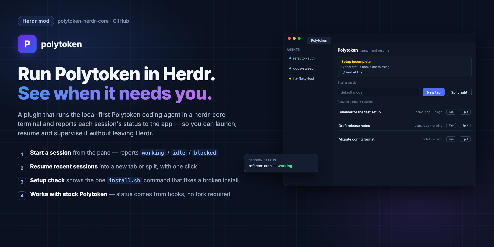

# polytoken-herdr-core



Run [Polytoken](https://docs.polytoken.dev/) in a [herdr-core](https://github.com/herdrdev/herdr-core) terminal and see when it is working or waiting for you.

The adapter translates Polytoken's built-in Herdr reporter into herdr-core status. It needs no Polytoken status hooks or relay socket. A terminal proxy keeps callback status from interrupting TUI control sequences. You handle agreements, permissions and questions in the TUI yourself. The project remains experimental; [the verification record](docs/review.md) distinguishes the callback probe from stock-Polytoken and human checks.

## Install

You need Python 3.10+, `hc` and `polytoken` on PATH, and a working Polytoken model configuration. The adapter uses Python's standard library and Unix `/dev/tty`. Linux has not been runtime-tested here; Windows is unsupported.

```sh
git clone https://github.com/sjennings/polytoken-herdr-core
cd polytoken-herdr-core
./install.sh
```

The installer links the launcher into `~/.local/bin`, the agent skill into `~/.claude/skills`, and the Polytoken mod into the Herdr app. It adds the menu entry and icon, preserves unrelated programs and custom match aliases, and adds the `firstmate-polytoken` alias. The entry's launch command is `polytoken-herdr run --global`.

Both `./install.sh` and `./uninstall.sh` remove obsolete global hooks from the old adapter, including entries pointing at a moved checkout. Other hooks stay in place. The first `hooks.json.herdr-backup` and `programs.json.herdr-backup` are retained. Rerun the installer after moving the checkout; the reporter calls the adapter by its absolute path.

## Use in the Herdr app

Start Polytoken from the app's agent menu in your project folder. The app manages the terminal controls automatically. You still decide any agreement, permission or question.

Open the optional Polytoken pane:

```sh
herdr-app do tab.new --name Polytoken --mod polytoken
```

The pane's **New tab** and **Split right** buttons accept an optional model. Its recent-session list uses Polytoken's stored history; **Tab** and **Split** call `run --global --continue SESSION_ID` from the session's project folder. It checks for the launcher and menu entry without requiring hooks. The layout is unchanged. See [the pane recipe](RECIPE.md) and [screenshot](docs/screenshot.png).

## Use herdr-core directly

Run in the current terminal, including through the shell alias `polytoken='polytoken-herdr run --global'`:

```sh
polytoken-herdr run --global
polytoken-herdr run --global --model YOUR_MODEL --prompt 'Inspect the project.'
polytoken-herdr run --global --continue SESSION_ID
```

Outside herdr-core, `run` invokes native Polytoken without adding reporter variables or a private registry. Inside herdr-core, a new session gets a private registry that is reaped on exit. Resuming an existing session uses Polytoken's native registry and leaves its daemon running on detach.

To create a separate terminal:

```sh
polytoken-herdr launch --global --name worker --cwd /absolute/project \
  --model YOUR_MODEL --prompt 'Inspect the project.'
hc attach worker
```

Ctrl+\\ detaches the viewer. For direct herdr-core users, `hc get worker` reads status, `hc send worker 'Next task' --if idle --wait` sends ordinary work, and `hc kill worker` followed by `hc rm worker` finishes it. Never use sends to answer an agreement or bypass a blocked decision.

The adapter records the session ID and registry as terminal labels. `polytoken-herdr restore` resumes those labels from the same terminal. It validates the ID and never executes a callback's supplied resume command. Restoration still needs a stock-TUI runtime check.

## Upgrade from hooks

`prepare --global` now removes obsolete global adapter hooks; it installs none. `remove --global` does the same cleanup. To migrate an old project configuration, run:

```sh
polytoken-herdr prepare /absolute/project/.polytoken
```

This creates the directory if needed or removes only obsolete adapter hooks from an existing one. Provider configuration and unrelated hooks are preserved. `run --config DIRECTORY` and `launch --config DIRECTORY` still pass that directory to Polytoken; status no longer depends on where hooks are discovered.

## Status and limits

Polytoken owns status decisions: `working` includes pending background work, `idle` means no turn or background work is pending, and `blocked` means a human decision is needed. Release clears status. Idle does not establish task success; the adapter never reports `done`.

The bridge removes the old asynchronous hook reduction and relay delivery path. It does not guarantee every report reaches herdr-core: a failed callback, stalled terminal or abrupt process death can still lose a report. Model and facet metadata have no equivalent in OSC 7501 and are ignored. Setting the legacy Herdr environment also activates Polytoken's documented Herdr detection, including its keyboard-mode behavior and bundled skill.

See [setup and recovery](docs/usage.md) and [verification and remaining checks](docs/review.md).

## Source of the approach

The built-in-reporter bridge was suggested by [Timo Freiberg's `herdr-polytoken` wrapper](https://github.com/TimoFreiberg/dotfiles/blob/main/bin/herdr-polytoken). No licence covering that script was found in its repository on 2026-11-12. This Python implementation was written independently; no wrapper text was copied. Polytoken documents the reporter in [TUI Orchestrators](https://docs.polytoken.dev/using-polytoken/tui-orchestrators/) and dates baseline Herdr support to 0.8.18 in its [changelog](https://docs.polytoken.dev/changelog/). That baseline date does not establish callback-ABI compatibility with every older release.
