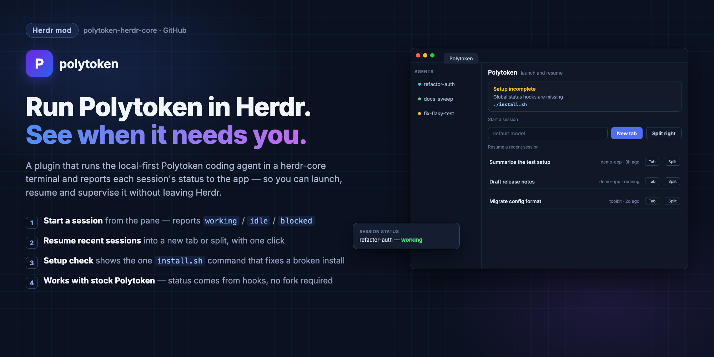

# Polytoken

A small pane for the polytoken-herdr-core plugin: start a Polytoken session
that reports its status to Herdr, resume a recent stored one, and see — and
fix with one command — when the plugin is not fully installed. It is a
launcher and a setup check, not a second agent list; the app's sidebar
already shows every running agent and its status.

## What you see

One column, 12 px padding, theme `background`, all text in the UI font.

- **Header**, one row: "Polytoken" in 13 px semibold, "launch and resume"
  in 11.5 px `dim` beside it.
- **Setup card** (only when something is missing): a `surface` card with an
  8 px radius and a 1 px `border`, "Setup incomplete" in 12.5 px semibold
  `blocked`, one 12 px `muted` line per problem (launcher, app-menu entry,
  global hooks), the fixing `install.sh` command in 12 px semibold `accent`,
  and a "Check again" button.
- **Start a session**: an 11.5 px `dim` label, then a row with a 28 px
  model input (`surface` background, `input` border, placeholder "default
  model"), a solid "New tab" button and a bordered "Split right" button,
  both 28 px high, 12.5 px text, 6 px radius.
- **Resume a recent session**: an 11.5 px `dim` label with a bordered
  "Refresh" button, then up to 12 rows, 30 px each: the session title
  (or its last message, or its ID) truncated in 12.5 px, the project
  folder name and last activity ("3h ago", or "running" while its daemon
  is up) in 11.5 px `dim`, and two
  22 px bordered buttons, "Tab" and "Split". While reading, with nothing
  stored, or when `polytoken` cannot list sessions, one 12 px `muted`
  line says so.

## How it behaves

- Typing a model name and pressing **New tab** opens a new tab running the
  adapter's `run --global` mode with `--model <name>` appended when the
  field is not empty; **Split right** splits the focused pane instead; the
  field's Enter key opens the tab. The launched session reports `working`,
  `idle` and `blocked` like every Herdr agent.
- The resume list is read when the pane opens and on "Refresh": stored
  sessions from `polytoken sessions --all --format json`, newest first,
  leaving out subagent sessions and legacy records without metadata.
  Running sessions stay listed: a detached daemon is resumable, and
  `polytoken continue` reattaches it. "Tab" opens a new tab and "Split" splits the focused pane,
  both running the launcher with `--continue <id>` from the session's
  project folder. The resumed session is expected to report status like a
  new one; that is not yet verified at runtime.
- The setup check runs when the pane opens and when "Check again" is
  pressed. It reads; it never installs, repairs or writes anything.
- With nothing missing, the setup card is absent.

## Built from

- One mod, `mods/polytoken/`: `mod.json` `{ "place": "none" }` (it appears
  only where a tab or split puts it: `tab.new --mod polytoken`,
  `pane.split --mod polytoken`), no props. `main.js` default-exports one
  `View` holding an `InputState`.
- `herdr`: `focused()`, `home()`, `appHome()`, `knownAgents()` (the
  app-menu `run` argv), `exec()` three ways (`sh -c` reading
  `${XDG_CONFIG_HOME:-$HOME/.config}/polytoken/hooks.json`; `sh -c`
  resolving the mods symlink so the install command names the checkout
  that holds `install.sh`; `polytoken sessions --all --format json`),
  `run()`, `theme()`. Commands: `tab.new {name, argv}`,
  `pane.split {direction, pane, argv}`.
- Node built-ins: `fs/promises` (`stat` on `~/.local/bin/polytoken-herdr`).
- Sessions launch through the `polytoken` entry the plugin's `install.sh`
  writes to `programs.json`, falling back to the linked launcher. The
  status reporting itself comes from polytoken-herdr-core's hooks, not from
  this mod.
- No icons or art; the status colors are the theme's.

## Watch out

- `herdr-app check` proves only the first render; the setup card's three
  states and a real launch need the live app.
- The mod is trusted code with command access. It runs three read-only
  commands: `sh -c cat` of the hooks file, `sh -c readlink -f` of its own
  mods entry, and `polytoken sessions --all --format json`. It reads the
  user's `programs.json` via `knownAgents()`. Resuming starts the launcher
  through `sh -c 'cd -- "$1" && shift && exec "$@"'` in the project folder.
- `knownAgents()` decides the launch argv; without the `programs.json`
  entry the pane falls back to `~/.local/bin/polytoken-herdr run --global`
  and the setup card flags the missing menu entry anyway.
- Sessions started through the adapter use a private registry that is
  deleted on exit, so they never appear in the resume list; the list shows
  Polytoken's own stored history. A resumed session runs in Polytoken's
  default registry and the adapter does not reap it, so closing its tab
  leaves the daemon running, detached. Polytoken reports no TUI
  attachment, so the list cannot hide a running session that is open in
  another terminal. Whether status binds on resume (the daemon must report
  `session_start`) is not yet runtime-tested.
- A copied (not linked) mod cannot name its checkout, so the setup card
  shows `./install.sh` with a note to run it from the checkout.
- With `XDG_CONFIG_HOME` set, the hooks check follows it, matching the
  adapter's own config discovery.

## Done when

- `herdr-app check mods/polytoken` passes.
- With the plugin installed, opening the pane shows no setup card; after
  `./uninstall.sh` it lists the missing pieces and the `install.sh`
  command.
- "New tab" with a model opens a tab whose agent turns `working` during a
  model turn.
- Not yet verified: a stored session's "Tab" button resumes it in a new
  tab that reports status, and a closed resumed tab's session comes back
  as "running" and reattaches.
- `tests/test_plugin_scripts.py` links and unlinks the mod with the rest of
  the plugin.
